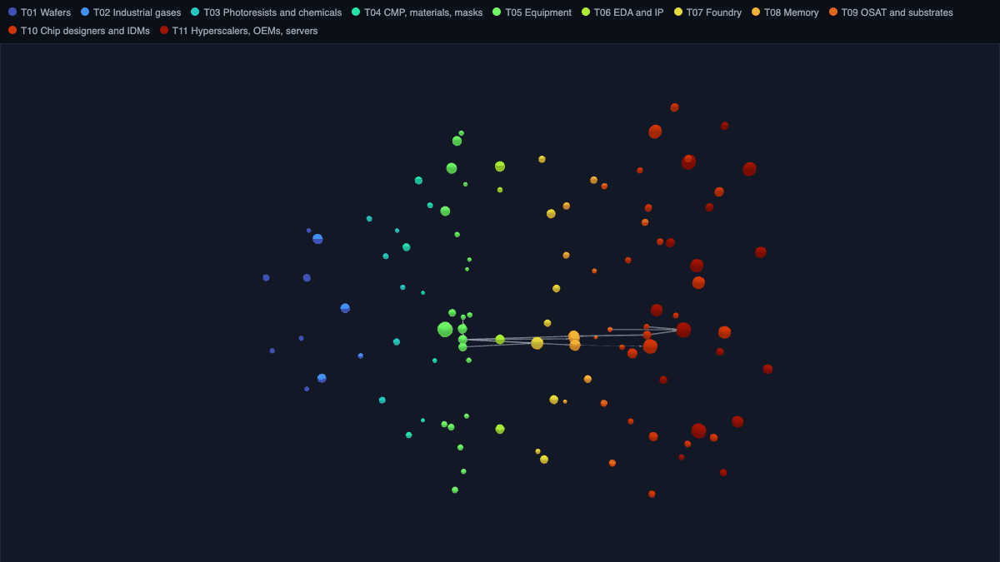
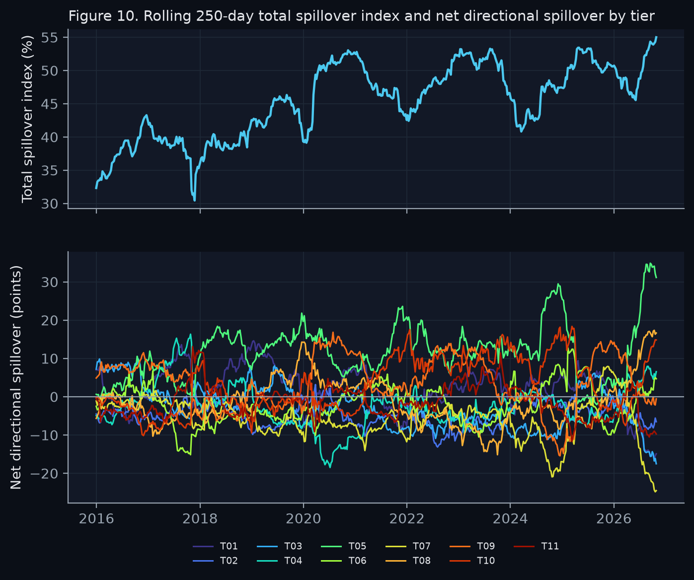

# supply-chain-graph

[](https://github.com/vendraholdings/supply-chain-graph/actions/workflows/ci.yml)

A directed supplier-to-customer graph of 111 listed semiconductor companies in eleven tiers, with the source and filing date of every edge,
and tests of how shocks and returns move across the tiers.

> **Status.** The graph holds 16 sourced supplier-customer pairs (39 edge-years) covering 15 companies. Automated extraction from SEC filings is implemented and
> tested, but it has not been run on the full filing set, so the edge-based results below are descriptive and the customer-momentum strategy cannot be estimated yet
> (at most 5 suppliers have a usable signal in any month). Price-based results do not depend on the edge set.



*Figure 1. The universe in three dimensions, tiers from wafers (blue) to hyperscalers (red), sized by market capitalisation; arrows run from supplier to customer.
An interactive version with the filing behind every edge is on the [project page](https://vendraholdings.github.io/supply-chain-graph/).*

## Results

| Quantity | Value |
|---|---|
| Sourced supplier-customer pairs (edge-years) | 16 (39) |
| Total spillover index, eleven tier indices, ten-day horizon (weekly data) | 42.6% (49.4%) |
| Price shocks studied | 3,940 |
| CAAR of direct suppliers over days 0 to 20 after a customer shock (n, adjusted t) | -1.6% (49, -1.0) |
| Rejection rate of the 5% event-study test on random dates (direct suppliers) | 5.6% |

Equipment and packaging are the net transmitters of spillovers (+11.6 and +5.5 points); foundry and industrial gases are the net receivers (-7.5 and -4.6).
No abnormal return of suppliers, customers or companies two links away is significant at the 5% level, with 49 to 63 events per group and low power.
Lead-lag correlations between tiers are mostly an effect of closing-time order between Asian and US markets. Every number above is generated by the code in this repository and quoted, with its method, in the [paper](paper/paper.pdf).

* **Live page:** <https://vendraholdings.github.io/supply-chain-graph/>
* **Paper:** [`paper/paper.pdf`](paper/paper.pdf)



*Figure 10. Rolling 250-day total spillover index and net directional spillover by tier.*

## Method

| Part | Approach |
|---|---|
| Graph | Edges from annual reports and filings with filing date, availability date, expiry and source URL; point-in-time use only |
| Edge extraction | Sentence rules and a locally run open-weights language model must agree; disagreements go to a review queue; responses are cached for replay |
| Customer momentum | Cohen and Frazzini (2008) design with costs, Newey-West and Fama-MacBeth alpha, a declared grid of 48 variants and degree-preserving rewiring as falsification |
| Event study | Large one-day moves, market model with Dimson terms, time-zone-aware day 0, adjusted standardised test, placebo size check |
| Spillover | Generalised forecast-error variance decomposition (Diebold and Yilmaz, 2012) on eleven tier indices |
| Lead-lag | Cross-correlations at lags of -5 to +5 days with stationary-bootstrap intervals |

## Graph interface

`data/derived/graph.json` holds `nodes` (ticker, name, tier, country, market capitalisation) and `edges` (supplier, customer, weight, validity dates, sources). In Python:

```python
from scgraph.api import neighbours
neighbours("LRCX", depth=1, direction="both")   # dicts: ticker, relation, hops, weight, sources
```

## Reproduce

Requires [uv](https://docs.astral.sh/uv/). Raw vendor prices are not included; `make prices` downloads them (see the fair-access note below). Derived results are committed.

```bash
git clone https://github.com/vendraholdings/supply-chain-graph
cd supply-chain-graph
make setup test      # environment and tests
make figures site    # figures and the static site
make serve           # http://localhost:8000
```

`make paper` compiles `paper/paper.pdf` and `make readme` renders this file from `README.md.tmpl`.

## Data and fair access

Prices come from a free vendor and are used for research; they are not redistributed. Filings are fetched from SEC EDGAR at no more than five requests per second with a declared contact identification, and are cached locally.
Source documents for curated edges are linked, not copied.

## Layout

```
scgraph/    universe  prices  fx  calendars  returns  edges  edgar  extract_rules  extract_llm  auto_edges  graph  api
            momentum  events  spillover  leadlag  plots  theme  facts  privacy
scripts/    run_all  run_events  run_spillover  make_figures  record_hero  build_paper  build_readme  check_site
tests/      point-in-time edges, rate limiter, extraction replay, time-zone alignment, placebo size, spillover on a simulated VAR, API
site/       build.py  template.html  vendor/  (static page; scripts bundled, no external requests)
paper/      paper.typ.tmpl  refs.bib  paper.pdf
docs/       hero.gif
data/       universe.csv  edges_curated.csv  derived/graph.json
results/    summary.json  tables  figures/
```

## References

- Cohen, Frazzini (2008). Economic Links and Predictable Returns. *Journal of Finance* 63(4).
- Menzly, Ozbas (2010). Market Segmentation and Cross-predictability of Returns. *Journal of Finance* 65(4).
- Diebold, Yilmaz (2012). Better to Give than to Receive. *International Journal of Forecasting* 28(1).
- Kolari, Pynnönen (2010). Event Study Testing with Cross-sectional Correlation of Abnormal Returns. *Review of Financial Studies* 23(11).
- Boehmer, Musumeci, Poulsen (1991). Event-study Methodology under Conditions of Event-induced Variance. *Journal of Financial Economics* 30(2).

Released under the MIT licence.
